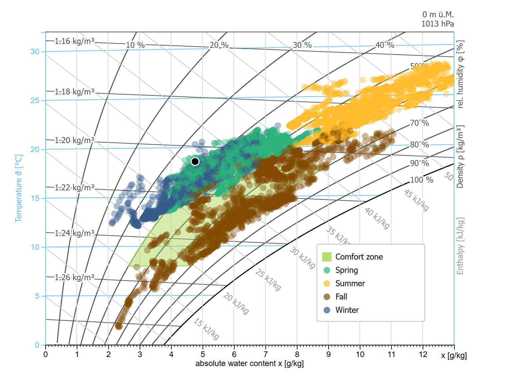
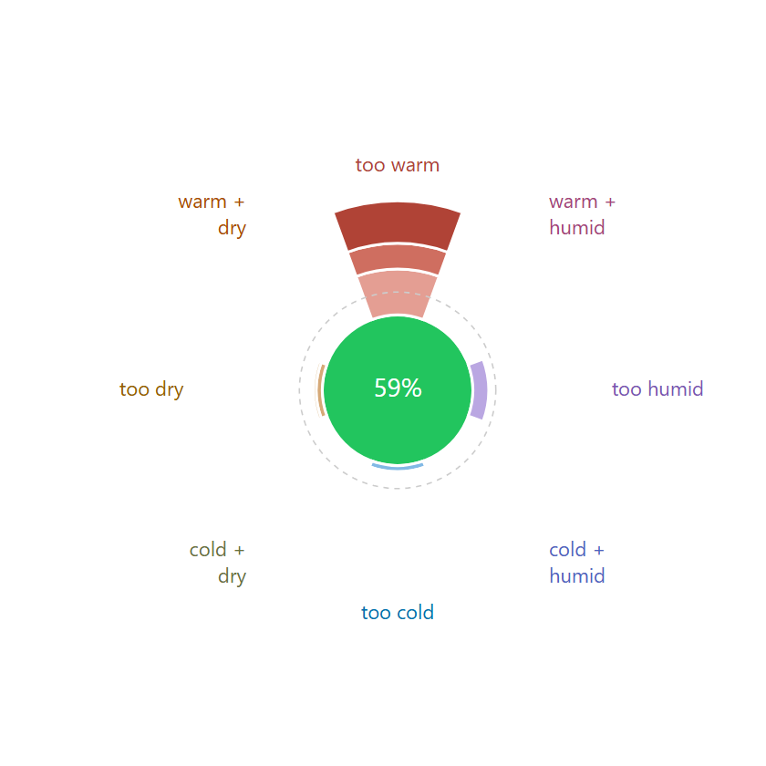
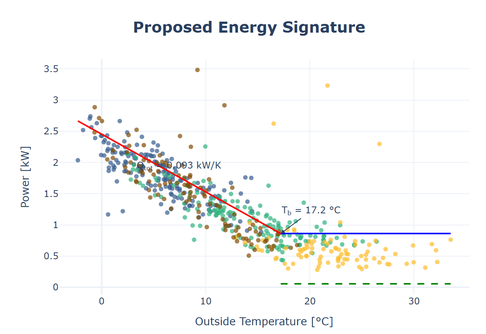

<p align="center">
  
</p>

<p align="center"><b><a href="https://retomarek.github.io/pyedautils/">Documentation, examples and guides: retomarek.github.io/pyedautils</a></b></p>

<p align="center">
  <a href="https://pypi.org/project/pyedautils/"></a>
  <a href="https://pypi.org/project/pyedautils/"></a>
  <a href="https://github.com/retomarek/pyedautils/actions/workflows/python-unittest.yml"></a>
  <a href="https://codecov.io/gh/retomarek/pyedautils"></a>
  <a href="https://pypi.org/project/pyedautils/"></a>
  <a href="https://retomarek.github.io/pyedautils/"></a>
  <a href="https://github.com/retomarek/pyedautils/blob/main/LICENSE.txt"></a>
</p>

<p align="center">Python Energy Data Analysis Utilities: a pip-installable library of compact utility functions for analyzing and visualizing energy and comfort time-series data.</p>

<p align="center">
  
  
  
</p>

> **In the browser: [d3-mollierhx](https://github.com/hslu-ige-laes/d3-mollierhx).** The h,x diagram of `plot_mollier_hx()` and `plot_mollier_hx_fast()` is drawn with the D3.js code of d3-mollierhx, bundled with pyedautils. Try it in the [live demo](https://hslu-ige-laes.github.io/d3-mollierhx/).

> **In Home Assistant: [Mollier hx Card](https://github.com/retomarek/mollier-hx-card) and [Comfort Compass Card](https://github.com/retomarek/comfort-compass-card).** The h,x diagram and the comfort compass as dashboard cards, with the same comfort zone and warning bands, fed by the daily means of your temperature and humidity sensors.

## Why pyedautils

Energy and comfort data from buildings are time series: meter readings, room sensors, weather stations. The same steps come up in every analysis: load and check the data, prepare it, correct for the weather, and plot it so that it can be read at a glance. pyedautils bundles these steps as compact functions on pandas DataFrames, with plots that building-physics people know (h,x diagram, energy signature, SIA 180) and Swiss data sources (MeteoSwiss, Agrometeo, BFE) built in.

## Features

- **Data I/O**: Save/load DataFrames in CSV, pickle, compressed pickle, and JSON formats
- **Data quality**: Gap, stuck-value and range-outlier detection, interval inference, ok/warning/critical flags, missing-value plots
- **Thermal comfort**: SIA 180:2014 adaptive comfort curves, summer-half-year filter, overheating hours/KPIs (Minergie / SIA 180), comfort-compass distribution
- **Psychrometrics**: Moist-air states (dew point, wet bulb, enthalpy, density) and air-handling processes (heating, cooling, humidification, mixing, heat recovery)
- **Energy signature**: Proposed Energy Signature (Eriksson et al. 2020): balance temperature, heat loss coefficient, DHW and circulation demand
- **Unit conversion**: SI ↔ IP conversions for psychrometric quantities, including whole moist-air states
- **Degree days / climate correction**: Swiss HGT 20/12, ATD (SIA 380), CDD, reference climatology, SIA-380-style normalization, fixed-base degree-day regression (ASHRAE G14 metrics), BFE GT&S method
- **Geocoding**: Address geocoding, WGS84/LV95 conversion, altitude lookup, Swiss postal codes, Haversine distance
- **Plotting**: Plotly- and D3-based visualizations:
  - daily profiles with confidence bands, median-week and calendar heatmaps
  - energy signature (simple and PES), seasonal plots (overlapping, miniplots, before/after, polar), density by season
  - comfort: SIA 180, Mollier h,x-diagram, comfort compass, comfort donuts, overheating, temperature/humidity time series (how to read them: see the [guides](#reading-the-diagram-comfort-and-saving-energy))
  - statistics: sum frequency, STL decomposition, distribution, boxplot, outliers, correlation, scatter, autocorrelation
  - heating/cooling gradient boxplots, solar-influence dual-axis plot
  - degree days vs. reference, degree-day regression
- **Data preparation**
  - **Season detection**: Astronomical or meteorological season classification for any date
  - **Solar position**: Sun elevation and azimuth for a location and time (single timestamp or vectorized over a pandas Series/DatetimeIndex)
  - **Gradients**: Heating/cooling gradients (K/h) by direction and season
  - **Solar influence**: Detect direct solar influence on a sensor
  - **Reshape**: Per-id resampling of long-format data, IQR outlier removal, long-to-wide pivoting
- **Swiss weather data**
  - **MeteoSwiss**: Download historical 10-minute/hourly/daily data (open data portal) by station or postal code, current measurements, nearest station by sensor type and altitude
  - **Agrometeo.ch**: Station list, nearest station, download of hourly weather data by station or postal code
  - **Swiss open data**: Monthly degree-day series of the BFE and the Stadt Zürich

## Requirements

Python 3.9 or newer. The dependencies (pandas, NumPy, SciPy, statsmodels, Plotly, ephem, geopy, pgeocode, requests) are installed with the package.

## Installation

```bash
pip install pyedautils
```

## Quick start

```python
from pyedautils.plots import plot_daily_profiles_overview
from pyedautils.data_io import load_data

df = load_data("my_data.csv")
fig = plot_daily_profiles_overview(df)
fig.show()
```

## Documentation

Full API reference, examples with interactive plots, and usage guides:

**[retomarek.github.io/pyedautils](https://retomarek.github.io/pyedautils/)**

Learning Python for energy and comfort data? The online book **[EDAP: Energy Data Analysis with Python](https://retomarek.github.io/edap/intro.html)** walks through loading, cleaning and plotting real building data step by step, using pyedautils.

## Reading the diagram, comfort and saving energy

New to the h,x diagram or the comfort compass? Two short guides explain how to read them correctly, what the comfort zone means and how to save energy, with worked examples (dew point and mould, ventilating in winter, heating less, humidifying, airing a cellar, summer night cooling) computed with pyedautils:

- [The h,x diagram in five minutes](https://retomarek.github.io/pyedautils/guides/mollier_hx.html): [reading the diagram](https://retomarek.github.io/pyedautils/guides/mollier_hx.html#hx-reading-the-diagram), [comfort](https://retomarek.github.io/pyedautils/guides/mollier_hx.html#hx-comfort), [saving energy](https://retomarek.github.io/pyedautils/guides/mollier_hx.html#hx-saving-energy)
- [Reading the comfort compass](https://retomarek.github.io/pyedautils/guides/comfort_compass.html): [reading the compass](https://retomarek.github.io/pyedautils/guides/comfort_compass.html#compass-reading-the-diagram), [comfort](https://retomarek.github.io/pyedautils/guides/comfort_compass.html#compass-comfort), [saving energy](https://retomarek.github.io/pyedautils/guides/comfort_compass.html#compass-saving-energy)

## Related projects

- [EDAP: Energy Data Analysis with Python](https://github.com/retomarek/edap): an interactive online book on analysing and visualising energy and comfort time series with pandas, Plotly and pyedautils ([read the book](https://retomarek.github.io/edap/intro.html)).
- [d3-mollierhx](https://github.com/hslu-ige-laes/d3-mollierhx): the interactive Mollier h,x diagram for the browser, built on D3.js ([live demo](https://hslu-ige-laes.github.io/d3-mollierhx/)).
- [Mollier hx Card](https://github.com/retomarek/mollier-hx-card): the h,x diagram as a Home Assistant dashboard card, with outside air and ventilation line.
- [Comfort Compass Card](https://github.com/retomarek/comfort-compass-card): the comfort compass as a Home Assistant dashboard card: how many days were too warm, too humid, too dry or too cold.

## Questions and feedback

- **Questions or ideas?** Ask in [Q&A](https://github.com/retomarek/pyedautils/discussions/categories/q-a).
- **Found a bug or want a feature?** Open an [issue](https://github.com/retomarek/pyedautils/issues/new/choose).
- **Find it useful?** A star on GitHub helps others find it.

## Repository images

`docs/logo.svg` is generated by `scripts/make_logo.py`. `docs/banner.png` (README header), `docs/social-preview.png` (GitHub social preview, 1280×640), the docs sidebar logo and favicon (`docs/images/logo-docs.png`, `docs/images/favicon.png`) and the example plots they use (`docs/images/branding_*.png`, also the images at the top of this README) are rendered with headless Chromium by `scripts/render_branding.py`:

```bash
python scripts/make_logo.py
uv run --no-project --with playwright python -m playwright install chromium   # once
uv run --no-project --with playwright --with-editable . python scripts/render_branding.py
```

The social preview has to be uploaded manually under *Settings → General → Social preview* (there is no API for it).

## License

MIT © Reto Marek, see [LICENSE.txt](https://github.com/retomarek/pyedautils/blob/main/LICENSE.txt).
