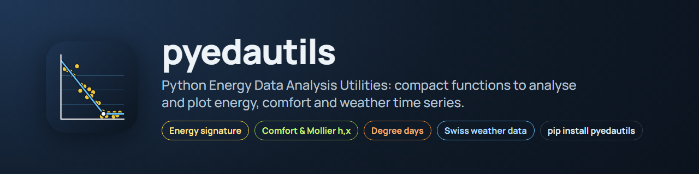

<p align="center">
  
</p>

[](https://github.com/retomarek/pyedautils/actions/workflows/python-unittest.yml) [](https://codecov.io/gh/retomarek/pyedautils)
[](https://pypi.org/project/pyedautils) [](https://pypi.org/project/pyedautils/) [](https://retomarek.github.io/pyedautils/) [](https://github.com/retomarek/pyedautils/blob/main/LICENSE.txt)

**[Documentation, API reference and examples with interactive plots → retomarek.github.io/pyedautils](https://retomarek.github.io/pyedautils/)**

A pip-installable library of compact utility functions for analyzing and visualizing energy and comfort time-series data.

## Features

- **Data I/O** — Save/load DataFrames in CSV, pickle, compressed pickle, and JSON formats
- **Data quality** — Gap, stuck-value and range-outlier detection, interval inference, ok/warning/critical flags, missing-value plots
- **Thermal comfort** — SIA 180:2014 adaptive comfort curves, summer-half-year filter, overheating hours/KPIs (Minergie / SIA 180), comfort-compass distribution
- **Psychrometrics** — Moist-air states (dew point, wet bulb, enthalpy, density) and air-handling processes (heating, cooling, humidification, mixing, heat recovery)
- **Energy signature** — Proposed Energy Signature (Eriksson et al. 2020): balance temperature, heat loss coefficient, DHW and circulation demand
- **Unit conversion** — SI ↔ IP conversions for psychrometric quantities, including whole moist-air states
- **Degree days / climate correction** — Swiss HGT 20/12, ATD (SIA 380), CDD, reference climatology, SIA-380-style normalization, fixed-base degree-day regression (ASHRAE G14 metrics), BFE GT&S method
- **Geocoding** — Address geocoding, WGS84/LV95 conversion, altitude lookup, Swiss postal codes, Haversine distance
- **Plotting** — Plotly- and D3-based visualizations:
  - daily profiles with confidence bands, median-week and calendar heatmaps
  - energy signature (simple and PES), seasonal plots (overlapping, miniplots, before/after, polar), density by season
  - comfort: SIA 180, Mollier h,x-diagram, comfort compass, comfort donuts, overheating, temperature/humidity time series
  - statistics: sum frequency, STL decomposition, distribution, boxplot, outliers, correlation, scatter, autocorrelation
  - heating/cooling gradient boxplots, solar-influence dual-axis plot
  - degree days vs. reference, degree-day regression
- **Data preparation**
  - **Season detection** — Astronomical or meteorological season classification for any date
  - **Solar position** — Sun elevation and azimuth for a location and time (single timestamp or vectorized over a pandas Series/DatetimeIndex)
  - **Gradients** — Heating/cooling gradients (K/h) by direction and season
  - **Solar influence** — Detect direct solar influence on a sensor
  - **Reshape** — Per-id resampling of long-format data, IQR outlier removal, long-to-wide pivoting
- **Swiss weather data**
  - **MeteoSwiss** — Download historical 10-minute/hourly/daily data (open data portal) by station or postal code, current measurements, nearest station by sensor type and altitude
  - **Agrometeo.ch** — Station list, nearest station, download of hourly weather data by station or postal code
  - **Swiss open data** — Monthly degree-day series of the BFE and the Stadt Zürich

## Installation

```bash
pip install pyedautils
```

## Quick start

```python
from pyedautils.plots import plot_daily_profiles_overview
from pyedautils.data_io import load_data

df = load_data("my_data.csv")
fig = plot_daily_profiles_overview(df)
fig.show()
```

## Documentation

Full API reference, examples with interactive plots, and usage guides:

**[retomarek.github.io/pyedautils](https://retomarek.github.io/pyedautils/)**

## Questions and feedback

- **Questions or ideas?** Ask in [Q&A](https://github.com/retomarek/pyedautils/discussions/categories/q-a).
- **Found a bug or want a feature?** Open an [issue](https://github.com/retomarek/pyedautils/issues/new/choose).

## Repository images

`docs/logo.svg` is generated by `scripts/make_logo.py`. `docs/banner.png` (README header), `docs/social-preview.png` (GitHub social preview, 1280×640), the docs sidebar logo and favicon (`docs/images/logo-docs.png`, `docs/images/favicon.png`) and the example plots they use (`docs/images/branding_*.png`) are rendered with headless Chromium by `scripts/render_branding.py`:

```bash
python scripts/make_logo.py
uv run --no-project --with playwright python -m playwright install chromium   # once
uv run --no-project --with playwright --with-editable . python scripts/render_branding.py
```

The social preview has to be uploaded manually under *Settings → General → Social preview* (there is no API for it).

## License

MIT © Reto Marek, see [LICENSE.txt](https://github.com/retomarek/pyedautils/blob/main/LICENSE.txt).

**Disclaimer** — The author declines any liability or responsibility in connection with the published code and documentation.
